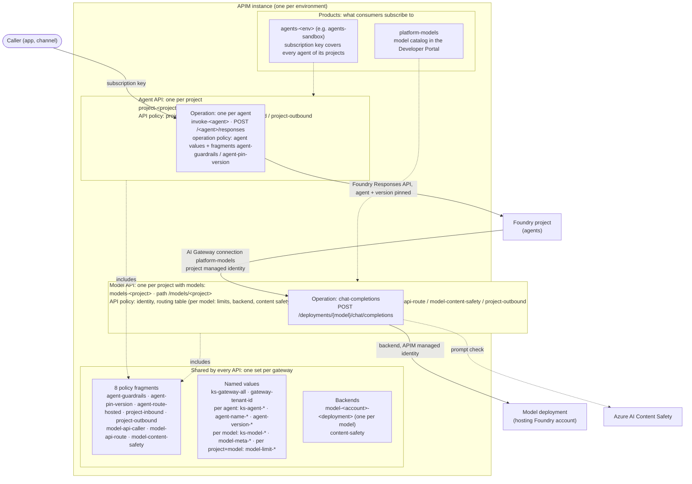
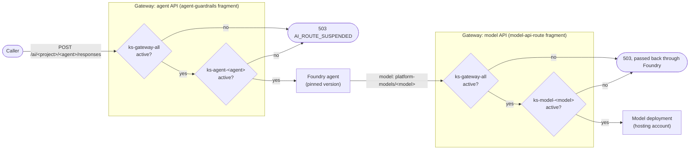

# AI gateway (platform repository)

The AI platform's gateway: one Azure API Management instance per environment, the Microsoft Foundry accounts that host
models and agents, and the shared gateway policy every use case runs through (kill switches, content safety, limits,
routing). Use cases (their Foundry projects, model access and agents) are onboarded and deployed from the project
repository, **[agent-deployment](https://github.com/DeepuMM/agent-deployment)**.

## Pipelines

Two GitHub Actions pipelines plus the platform stack, all signed in to Azure with GitHub OIDC (no secrets) except the
platform stack, which a platform engineer applies.

### 1. `model-platform-deployment`: host a model

| | |
|---|---|
| **What it does** | For each model under `gateway/foundry-accounts/<account>/models/<model>/`: deploys it in its hosting Foundry account (version, SKU, capacity) with its **guardrail**, then makes it **available** on the gateway: an APIM **backend** pointing at the deployment, a **registry entry** `model-meta-<model>` (what projects can request), a **kill switch** `ks-model-<model>` (created `active` once, never reset), and the model in the `platform-models` **catalog**. Smoke test (deployment healthy, backend registered, kill switch set), then publishes the Developer Portal. **It creates no API anyone can call:** each project gets its own callable model API, `models/<project>`, from use-case onboarding in the project repository, and that API routes to this one shared backend. |
| **Runs** | pull request touching `gateway/foundry-accounts/**`, `gateway/terraform/platform-deployment/**` or `platform/environments/**`: checks and plan; merge to `main`: plan, approval, apply, smoke test; on demand |
| **When the run fails** | During the apply, if Azure refuses a deployment (for example no quota or no permission). The plan also checks each model's definition (name the same as its folder, format allowed in its hosting account, `api` and `status` valid), but today these checks only **warn** and do not stop the run. |
| **Terraform** | `gateway/terraform/platform-deployment`, state `ai-gateway-models-<env>.tfstate` |

### 2. `gateway-policy-deployment`: the shared gateway policy

| | |
|---|---|
| **What it does** | Deploys the **policy fragments** in `gateway/policy-fragments/` (kill switches, limits, routing, identity check, content safety) that every project's agent API and model API include, the **global kill switch** `ks-gateway-all` (created `active` once), the named value `gateway-tenant-id`, and the **Content Safety backend** `content-safety` (managed identity). A change reaches every project at once, with no project redeployed. Gateway smoke test: every fragment is on the gateway, the global kill switch state, the model registry. |
| **Runs** | pull request touching `gateway/policy-fragments/**`, `gateway/terraform/gateway-policies/**` or `platform/environments/**`: checks and plan; merge to `main`: plan, approval, apply, smoke test, for **every** environment; on demand |
| **When the run fails** | **In the plan, so nothing has changed yet:** a fragment file doesn't start with `<fragment>`, or the environment file has no `gateway.content_safety`. **During the apply:** APIM refuses a fragment because its policy is invalid. Fragments applied before it in that run stay; fix the file and run again. |
| **Terraform** | `gateway/terraform/gateway-policies`, state `ai-gateway-policies-<env>.tfstate` |

### 3. Platform stack (`gateway/sandbox`, applied by a platform engineer)

Creates the platform an environment runs on: APIM, the Foundry accounts for models and for agents, the Azure AI
Content Safety account, Terraform state storage, the pipeline identity with its roles and its GitHub trust (for both
repositories), and APIM's own roles. Local state; see [gateway/sandbox/README.md](gateway/sandbox/README.md). Its
output `environment_file` is `platform/environments/<env>.yaml`.

### Variables

Set per GitHub environment (`sandbox`; test: `model-test`), as **variables**, not secrets:

| Variable | Used by | Value (sandbox) |
|---|---|---|
| `AZURE_CLIENT_ID` | both pipelines | client ID of the pipeline identity `id-sbx-pipeline` |
| `AZURE_TENANT_ID` | both pipelines | the platform tenant |
| `AZURE_SUBSCRIPTION_ID` | both pipelines | the subscription of APIM and the Foundry accounts |

Repository variable: `MODEL_ENVIRONMENTS`, the environments the pipelines may run in (`sandbox,test`).

Everything else comes from `platform/environments/<env>.yaml`: the APIM name and resource group (gateway URL
`https://<apim_name>.azure-api.net`), the agent Foundry account, the Content Safety account, the tenant, the Terraform
state storage. Hosting accounts are the folders under `gateway/foundry-accounts/` (`account.yaml`).

### Permissions

| Who | Role | Scope | For |
|---|---|---|---|
| Pipeline identity | **Foundry Account Owner** | each hosting Foundry account | model deployments and guardrails |
| | **API Management Service Contributor** | the APIM instance | backends, named values, fragments, products, portal |
| | **Reader** | the Content Safety account | lookup for the backend |
| | **Storage Blob Data Contributor** | the Terraform state container | state |
| | Federated credential | the identity, trusting `repo:<owner>@<id>/ai-gateway@<id>:environment:<env>` | GitHub OIDC sign-in |
| APIM managed identity (runtime) | **Foundry User** | each hosting account and the agent account | call the models and the agents |
| | **Cognitive Services User** | the Content Safety account | prompt checks |
| Platform engineer (platform stack) | Owner, or Contributor + Role Based Access Control Administrator | the platform resource group | create resources and role assignments |

Step-by-step flows, triggers and validation of both pipelines: [gateway/README.md](gateway/README.md).

The project repository's pipelines use the same pipeline identity with further roles on the agent account (see its
README). In the sandbox, `id-sbx-pipeline` has Contributor on the resource group, which covers the Contributor-level
rows.

## Two repositories

| | **ai-gateway**, this repository (platform team) | **agent-deployment** (use-case teams) |
|---|---|---|
| Platform | APIM, Foundry accounts for models and for agents, Content Safety (`gateway/sandbox`); `platform/environments/` (source of truth) | a copy of the environment files |
| Model hosting | `model-platform-deployment`: model deployments, registry, catalog | — |
| Shared gateway policy | `gateway-policy-deployment`: policy fragments, global kill switch, Content Safety backend | — |
| Use-case onboarding | — | `use-case-onboarding`: Foundry project, model API, token budget, content safety settings, connected models |
| Agent deployment | — | `agent-deploy`: agent versions, evaluation gate, agent API, docs, smoke test |

The project repository never reads this repository's files: it reads what the gateway serves (the model registry
`model-meta-*`, the policy fragments) from APIM and stops with a clear message when something is missing.

## AI gateway (APIM) structure

Everything callers and agents reach goes through one API Management instance per environment (sandbox:
`apim-sbx-bbf0o`). Inside it, **each project gets one agent API with one operation per agent**, and **each project
that lists models gets one model API**. The logic they share lives once per gateway (policy fragments, named values,
backends).



### What is in the sandbox gateway today

```text
apim-sbx-bbf0o
├── Products
│   ├── agents-sandbox ─────────────── APIs: project-models-demo, project-proj-default   (subscription key)
│   └── platform-models ────────────── API:  models-models-demo                          (catalog; called with Entra token)
├── APIs
│   ├── project-models-demo           /ai/models-demo                 agent API of project models-demo
│   │   └── invoke-demo-assistant          POST /demo-assistant/responses
│   ├── project-proj-default          /ai/proj-default                agent API of project proj-default
│   │   ├── invoke-expense-policy-agent    POST /expense-policy-agent/responses
│   │   └── invoke-leave-policy-agent      POST /leave-policy-agent/responses
│   ├── models-models-demo            /models/models-demo             model API of project models-demo
│   │   └── chat-completions               POST /deployments/{model}/chat/completions
│   └── models-proj-default           /models/proj-default            model API of project proj-default
│       └── chat-completions               POST /deployments/{model}/chat/completions
├── Policy fragments                  agent-guardrails, agent-pin-version, agent-route-hosted, project-inbound, project-outbound,
│                                     model-api-caller, model-api-route, model-content-safety
├── Named values
│   ├── gateway:  ks-gateway-all, gateway-tenant-id
│   ├── agents:   ks-agent-<agent>, agent-name-<agent>, agent-version-<agent>   (× 3 agents)
│   └── models:   ks-model-gpt-5-4-mini, model-meta-gpt-5-4-mini, model-limit-models-demo-gpt-5-4-mini
└── Backends                          model-aif-sbx-models-bbf0o-gpt-5-4-mini  →  aif-sbx-models-bbf0o/openai
                                      content-safety                           →  cs-sbx-bbf0o
```

### One per what, created by whom

| APIM object | One per | Name | Created by |
|---|---|---|---|
| Agent API | project | `project-<project>`, path `ai/<project>` | `agent-deploy` (`register`) |
| Agent operation | agent | `invoke-<agent>`, `POST /<agent>/responses` | `agent-deploy` (`register`) |
| Agent API policy / operation policy | project / agent | from the project repository's `templates/` | `agent-deploy` (`register`), project repository |
| `ks-agent-*`, `agent-name-*`, `agent-version-*` | agent | | `agent-deploy` (`register`) |
| Product `agents-<env>` | as set in `project.yaml` `gateway.product` | e.g. `agents-sandbox` | `agent-deploy` (`register`) |
| Foundry project (in the agent Foundry account, not in APIM) | project | `foundry.project` | use-case onboarding, project repository |
| Model API + its policy | project | `models-<project>`, path `models/<project>` | use-case onboarding, project repository |
| `model-limit-<project>-<model>` | project and model | | use-case onboarding, project repository |
| AI Gateway connection (in the Foundry project, not in APIM) | project | `models.connection`, unique per agent account | use-case onboarding, project repository |
| Model backend, `ks-model-*`, `model-meta-*` | model | `model-<account>-<deployment>` | `model-platform-deployment` |
| Product `platform-models` | gateway | | `model-platform-deployment` |
| Policy fragments, `ks-gateway-all`, `gateway-tenant-id`, backend `content-safety` | gateway | | `gateway-policy-deployment` |

The model deployment itself exists **once** per model in its hosting account; every project's model API routes to
the same deployment through the same backend. What differs per project is the front door: who may call it, which
models, how many tokens, which content safety settings.

### Policy layering: what runs on a call

APIM runs the operation policy, which calls the API policy at `<base />`. Thin per-project and per-agent policies
hold only their own values and include the shared fragments.

```text
Agent call   POST /ai/<project>/<agent>/responses   (caller's subscription key)
└─ operation policy  invoke-<agent>                         project repository: templates/agent-operation-policy.xml
   ├─ set variables: agent, ks-agent-<agent>, agent-name, agent-version, rate limit
   ├─ fragment agent-guardrails     global kill switch → agent kill switch → agent rate limit
   ├─ quota-by-key                  agent daily quota
   ├─ <base /> ─► API policy  project-<project>             project repository: templates/project-policy.xml
   │              ├─ set variable: project rate limit
   │              ├─ quota-by-key   project daily quota
   │              └─ fragment project-inbound   project rate limit, correlation ID,
   │                                            rewrite to /openai/v1/responses, APIM managed identity
   ├─ fragment agent-pin-version    agent_reference = agent name + evaluated version
   └─ outbound: <base /> ─► fragment project-outbound (correlation ID)
   ──► Foundry project runs the agent ──► the agent calls its model:

Model call   POST /models/<project>/deployments/<model>/chat/completions   (project's managed identity token)
└─ API policy  models-<project>                             project repository: onboarding/terraform/policies/…tftpl
   ├─ set variables: project, project resource ID
   ├─ fragment model-api-caller      Entra token check: only this project's identity (else 401)
   ├─ routing table (per allowed model): ks-model-<model>, token limits, backend, deployment,
   │                                     content safety settings (cs-*: model level, else project level), if any
   ├─ fragment model-api-route       global kill switch → 404 if model not allowed → model kill switch
   │                                 → token limit → backend → APIM managed identity
   ├─ fragment model-content-safety  Azure AI Content Safety on the prompt (403 if flagged)
   └─ outbound: fragment project-outbound (correlation ID)
   ──► model deployment in the hosting account
```

See [Shared policy](#shared-policy-policy-fragments), [Kill switches](#kill-switches) and
[Content safety](#content-safety) for each part in detail.

## Layout

| Path | What it is |
|---|---|
| `gateway/sandbox/` | the disposable sandbox platform (Terraform, local state), see [gateway/sandbox/README.md](gateway/sandbox/README.md) |
| `gateway/foundry-accounts/<account>/` | hosting accounts and their models (`model.yaml`, `docs.md`, `tests.yaml`) |
| `gateway/terraform/platform-deployment/` | model platform deployment stack |
| `gateway/policy-fragments/<id>.xml` | the shared policy logic, one APIM policy fragment per file |
| `gateway/terraform/gateway-policies/` | gateway policy stack: fragments, global kill switch, tenant, Content Safety backend |
| `gateway/scripts/` | model smoke test, Developer Portal publishing |
| `platform/environments/<env>.yaml` | platform coordinates per environment (the project repository keeps a copy) |
| `.github/workflows/` | `model-platform-deployment`, `gateway-policy-deployment` |

## Shared policy (policy fragments)

The gateway logic every agent shares (kill switch check, rate limit, forwarding to Foundry with managed identity,
pinning the evaluated version) is in APIM **policy fragments**, one per file in `gateway/policy-fragments/`.
Each agent operation and project API policy only sets its own values as context variables and includes the fragments:

```xml
<set-variable name="agent" value="expense-policy-agent" />
<set-variable name="agent-status" value="{{ks-agent-expense-policy-agent}}" />
<set-variable name="agent-rate" value="@(30)" />  ...
<include-fragment fragment-id="agent-guardrails" />
<quota-by-key calls="2000" renewal-period="86400" counter-key="..." />
<base />
<include-fragment fragment-id="agent-pin-version" />
```

| Change | Pipeline | Agents redeployed |
|---|---|---|
| `gateway/policy-fragments/*.xml` (shared logic) | `gateway-policy-deployment`: plan on the PR, apply on merge (environment approval), for **every** environment; then smoke-tests every project model API and agent on that gateway | none: every agent and model API uses the new fragment at once |
| the project repository's policy templates (which values are passed, which fragments are included) | that repository's `agent-deploy` / use-case onboarding | that repository's projects |
| an agent's limits or version | `agent-deploy`, that project | that project |

| Fragment | Included by | Does |
|---|---|---|
| `agent-guardrails` | agent operation policy, before `<base />` | global kill switch `ks-gateway-all` and agent kill switch (503), agent rate limit |
| `agent-pin-version` | prompt agent operation policy, after `<base />` | fixes `agent_reference` to the evaluated version |
| `agent-route-hosted` | hosted (code) agent operation policy, after `<base />` | routes to the agent's own endpoint `/agents/<agent>/endpoint/protocols/openai/responses`; strips `model` and `agent_reference` (the version is pinned in Foundry by the endpoint's version selector) |
| `project-inbound` | project API policy | project rate limit, correlation ID, Responses API, managed identity |
| `project-outbound` | project API policy, project model API policy | correlation ID on the response |
| `model-api-caller` | project model API policy (project repository's use-case onboarding) | only the project's Foundry identity (token claim `xms_mirid`; tenant from named value `gateway-tenant-id`) |
| `model-api-route` | project model API policy, after its routing table | global kill switch `ks-gateway-all` (503), 404 `MODEL_NOT_ALLOWED`, model kill switch, token limit, backend, managed identity |
| `model-content-safety` | project model API policy, after `model-api-route` | Azure AI Content Safety on the prompt (403 if flagged), settings per model (model, else project, else platform defaults), see [Content safety](#content-safety) |

The project model API policy keeps only its routing table (allowed models with their kill switch, token limits,
backend and deployment).

The daily quotas (`quota-by-key`) stay in the agent operation and project policies, with literal values: APIM accepts
no policy expression in `quota-by-key calls`. The rate limits and token limits take their values from context
variables (`llm-token-limit token-quota` must be a `long`, hence `@(…L)`).

### How the fragments are deployed

Only the `gateway-policy-deployment` workflow writes fragments (Terraform stack `gateway/terraform/gateway-policies`,
state `ai-gateway-policies-<env>.tfstate`), together with the named values they read directly: `gateway-tenant-id`
and the global kill switch `ks-gateway-all` (see [Kill switches](#kill-switches)), and the backends they call (the
Content Safety backend `content-safety`, see [Content safety](#content-safety)). It runs for **every** environment in `platform/environments/`, in that
environment's model GitHub environment (`test` → `model-test`), filtered by `MODEL_ENVIRONMENTS` when set:

1. Pull request: format, validate, plan tests, and a plan per environment.
2. Merge to `main`: plan → approval → apply → gateway smoke test (every fragment is on the gateway, the global kill
   switch, the model registry).

The project repository only references fragments by name: its `agent-deploy` (`register`) and use-case onboarding
plan check that the fragments they include are on the gateway, and stop with "run gateway-policy-deployment first"
if not. A fragment change is verified end to end by each project's next onboarding or agent run (or a manual run).

### Change the shared policy

1. Edit `gateway/policy-fragments/<id>.xml` (the file name is the fragment ID; the root element is `<fragment>`).
   A fragment reads its inputs from context variables; the comment at the top of each file lists them.
2. Open a pull request and review the plan of every environment.
3. Merge and approve the apply per environment. Every agent and model API uses the new logic at once.

A fragment change has no evaluation gate and reaches every project at once: review it like platform code. A new
fragment must be deployed (merged and applied) before a template that includes it is merged.

## Content safety

Every prompt sent to a platform model is checked by **Azure AI Content Safety at the gateway**, before it reaches
the model. This covers agent calls of every project and the evaluation gate's judge, because all of them reach models
through the project's model API (`models/<project>`). It is a second layer: the model deployment's own guardrail
(`guardrail` in `model.yaml`) still applies too, also to the model's answers.

| What is checked | Platform default | Blocked when |
|---|---|---|
| Harm categories **Hate**, **Sexual**, **SelfHarm**, **Violence** | threshold **4** each, on a severity scale from 0 (safe) to 7 | the prompt's severity in a category is at or above its threshold |
| **Prompt Shields** | on | the prompt is a jailbreak or prompt-injection attempt ("ignore your instructions…") |

A blocked prompt never reaches the model and uses no tokens. The model API returns **`403`** ("Request failed content
safety check"); an agent's caller gets the failure through Foundry. The check runs after the kill switches and the
allowed-model check, so suspended or refused calls cost no Content Safety call.

### Per project and per model

Content safety is resolved **per model** of each project, in this order:

1. the **model's** own setting: `models.allowed[].content_safety`
2. else the **project's** setting: `models.content_safety` (applies to every model of the project)
3. else the **platform default**: severity `4` per category, Prompt Shields on

So two models in one project can have different settings, for example a stricter one for a model that is less
safe on its own. Settings can only be **stricter** than the platform, at both levels: a category from `0` to `4`
(lower blocks more), and `prompt_shields` can only be `true`. The project repository's `agent-ci` and onboarding plan
reject anything else; the settings live in its `project.yaml`.

```yaml
models:
  connection: platform-models
  content_safety:              # project level, optional: every model of the project
    self_harm: 3
  allowed:
    - name: gpt-5.4-mini       # no model level -> self_harm 3 (project), hate/sexual/violence 4 (platform)
      tokens_per_minute: 20000
      tokens_per_day: 500000
    - name: other-model
      tokens_per_minute: 5000
      tokens_per_day: 50000
      content_safety:          # model level, optional: this model only, on top of the project level
        violence: 2            # -> violence 2 (model), self_harm 3 (project), hate/sexual 4 (platform)
```

| Model | hate | sexual | self_harm | violence | prompt_shields |
|---|---|---|---|---|---|
| `gpt-5.4-mini` | 4 (platform) | 4 (platform) | **3** (project) | 4 (platform) | on (platform) |
| `other-model` | 4 (platform) | 4 (platform) | **3** (project) | **2** (model) | on (platform) |

The settings reach every agent that uses the project's AI Gateway connection with that model. Today no project sets
`content_safety`: both sandbox projects run on the platform defaults.

### Content Safety checks the latest user message only

`llm-content-safety` joins every message of a request into one text before it asks Azure AI Content Safety. Foundry
puts a developer message ahead of every agent call ("You are an AI assistant accessed via an API...", plus the agent's
instructions), and joined with it Content Safety rates even a severity-5 prompt as 0: until 17 Nov 2026 the gateway
check blocked nothing on agent traffic (found in test with a copy of a real Foundry request). The fragment
`model-content-safety` now cuts the request down to the **latest user message** for the check and gives the model the
full request afterwards. Proved in test with Foundry's request shape: a Violence-3 prompt is blocked at a project
threshold of 2 and answered at the default 4; a Violence-5 prompt is blocked at both; normal questions pass.

### Known issue: Content Safety outages look like content blocks

**`llm-content-safety` fails closed:** when the Azure AI Content Safety service can't answer, APIM rejects the prompt
with the same `403 "Request failed content safety check"` as a real block. In the sandbox (17 Nov 2026) the account
`cs-sbx-bbf0o` (East US 2) answered `InternalError: no healthy upstream` to **7 of 28** checks in one test, so 7
legitimate questions got a `403`. The blocked and the allowed requests were byte-for-byte identical (agent
instructions as a `developer` message plus the user's question, one model call per answer); every one of the 7 blocks
was this service error, none was flagged content. Smoke tests through the gateway can therefore fail at random.

Not fixed yet. Options: a Content Safety account in another region, or two accounts behind an APIM backend pool with
a circuit breaker (to be checked: whether `llm-content-safety` accepts a pool), or removing the
`model-content-safety` include until then.

How to tell an outage from a real block: in the APIM gateway logs (`ApiManagementGatewayLogs`), both have
`LastErrorReason = ContentSafetyPolicyViolated`; an outage has `InternalError` in `LastErrorMessage`.

An earlier test with `violence: 2` seemed to block 3 legitimate questions; that was before this was found and was most
likely the same outages, so it says nothing about the threshold. Before tightening a project, run its smoke tests and
evaluation datasets through the gateway and check the gateway logs for the cause of each `403`.

### How it is built

| Piece | Where | Deployed by |
|---|---|---|
| The check, with the platform defaults | fragment `model-content-safety` (`llm-content-safety`), included by every project model API after `model-api-route` | `gateway-policy-deployment` |
| A project's and its models' settings | in its model API policy, each model's routing-table branch sets `cs-hate`, `cs-sexual`, `cs-self-harm`, `cs-violence`, `cs-prompt-shields` for what the model or the project sets (model level wins); the fragment reads each with its platform default | use-case onboarding, project repository |
| Azure AI Content Safety account (S0, key auth off) | `gateway.content_safety` in the environment file (sandbox: `cs-sbx-bbf0o`, created by `gateway/sandbox`) | the platform's infrastructure |
| APIM backend `content-safety` (managed identity) | `gateway/terraform/gateway-policies` | `gateway-policy-deployment` |
| APIM managed identity: **Cognitive Services User** on the account | `gateway/sandbox` (the pipeline identity can't assign roles) | the platform's infrastructure |

To change the **platform defaults**, edit `gateway/policy-fragments/model-content-safety.xml` (every project without
its own setting follows at once), and the "stricter only" limit in the project repository (`scripts/agent_pipeline.py`
and `onboarding/terraform/locals.tf`).

## Kill switches

A **kill switch** is an emergency stop on the AI gateway. Flipping it takes effect within seconds, with no
deployment, no pipeline run and no change in Git: the gateway simply refuses the calls it covers and answers
`503 AI_ROUTE_SUSPENDED`. Use it when an agent or a model misbehaves (wrong or harmful answers, a data leak, a
runaway cost, an incident at the model provider) and you need it stopped *now*, before anyone has worked out a fix.

### The three switches

Each switch is an APIM **named value** whose value is `active` or anything else (by convention `suspended`).

| Switch (named value) | Stops | Who is affected | Created by |
|---|---|---|---|
| `ks-gateway-all` | **everything** on the gateway: every agent and every project model API | every caller of every project | `gateway-policy-deployment` (one per gateway) |
| `ks-model-<model>` | one **model** (e.g. `ks-model-gpt-5-4-mini`) | every agent and evaluation of every project that uses the model | `model-platform-deployment` (one per model) |
| `ks-agent-<agent>` | one **agent** (e.g. `ks-agent-expense-policy-agent`) | callers of that agent only; the project's other agents keep working | `agent-deploy` (`register`, one per agent) |

Use the narrowest switch that stops the problem: an agent's switch for a bad agent, a model's switch for a bad
model, the global switch only when you can't tell yet what is wrong or everything must stop.

### Where each switch is checked

An agent call crosses the gateway twice: once on the way in (the agent API), and once more when the agent calls its
model (the project's model API, through the AI Gateway connection). The switches are checked on those hops:



- **Fails closed.** Anything other than exactly `active` (case-insensitive) stops the route: `suspended`, `off`, a
  typo. A missing switch can't happen silently: APIM refuses to save a policy that refers to a named value that
  doesn't exist.
- **Before any cost.** The check comes before limits, Foundry and the model, so a suspended route uses no tokens.
- **Evaluations too.** The evaluation gate's judge reaches the model through the same model API, so a suspended
  model (or the global switch) also stops evaluations; the pipeline run then fails and the gateway keeps serving the
  previous agent version.

The *check* is in the shared policy fragments (`agent-guardrails`, `model-api-route`), so it is the same for every
agent and model. The *value* of `ks-agent-<agent>` and `ks-model-<model>` is read by each agent's or project's own
policy and handed to the fragment, because APIM resolves `{{named value}}` references when a policy is saved, not
per request. `ks-gateway-all` has a fixed name, so the fragments read it directly.

### What the caller sees

```http
HTTP/1.1 503 Service Unavailable
Retry-After: 300
Content-Type: application/json

{"error": {"code": "AI_ROUTE_SUSPENDED",
           "message": "This agent is suspended by the platform kill switch.",
           "correlationId": "..."}}
```

The message says which switch stopped the call: *This agent is suspended…*, *Model `<model>` is suspended…* or
*All AI routes on this gateway are suspended…*. A model or global stop on the second hop reaches the caller through
Foundry as a failed agent response.

### Stop and resume

In the Azure portal: **API Management → Named values → `<switch>` → Edit → value `suspended` → Save**. Set it back
to `active` to resume. With the Azure CLI (sandbox names shown):

```bash
# stop
az apim nv update -g rg-ai-gateway-sandbox -n apim-sbx-bbf0o --named-value-id ks-agent-expense-policy-agent --value suspended
# check
az apim nv show   -g rg-ai-gateway-sandbox -n apim-sbx-bbf0o --named-value-id ks-agent-expense-policy-agent --query value
# resume
az apim nv update -g rg-ai-gateway-sandbox -n apim-sbx-bbf0o --named-value-id ks-agent-expense-policy-agent --value active
```

The change reaches the gateway within seconds. Anyone who can edit the APIM instance's named values (Owner, Contributor or
**API Management Service Contributor** on it) can flip a switch; keep that list short.

### What the pipelines do with switches

- They **create** each switch `active`, once, and **never change it afterwards**. No deployment, apply or re-run
  ever re-enables a suspended route; resuming is always a deliberate human action.
- Smoke tests **skip** what is suspended instead of failing: a suspended agent is skipped by `agent_pipeline.py
  smoke`; with `ks-gateway-all` suspended, the agent smoke test and the agent part of the model access smoke test
  are skipped (the access-control check still runs).
- Deploying while a switch is suspended is allowed: a new agent version can be deployed, evaluated (if its model is
  active) and pinned, and goes live when the switch is set back to `active`.

### What a kill switch does not do

- It stops traffic **through the gateway** only. Someone with direct access to the Foundry project (Foundry User)
  can still call the agent there; agent-only accounts have no models, so such a call fails once the model or the
  global switch is suspended.
- It doesn't roll anything back or delete anything: the agent, its versions and the model deployment stay as they
  are. To fix the cause, change the agent (or roll back `agent-version-<agent>`, see below) and resume.

## One-time setup per APIM instance

- **Developer Portal:** open it once from the Azure portal (APIM → Developer portal) so Azure provisions it;
  after that every deployment publishes it.
- **Sign-in (test, `apim-agents-3471ad`):** the portal uses Microsoft Entra ID (app registration
  `apim-agents-3471ad developer portal`); self sign-up with email and password is off. Renew the app secret before
  it expires (November 2027). The sandbox portal (`apim-sbx-bbf0o`) shows the products to anonymous
  visitors too (`portal_anonymous: true`).
- **Shared policy fragments:** run `gateway-policy-deployment` for the environment before the first `agent-deploy`.

## Environments

Each run targets one platform environment through the GitHub environment of the same name (`sandbox`; test:
`model-test`), whose variables hold the pipeline identity (`AZURE_CLIENT_ID`, `AZURE_TENANT_ID`,
`AZURE_SUBSCRIPTION_ID`, GitHub OIDC, no secrets). The repository variable `MODEL_ENVIRONMENTS` lists the environments
the pipelines may run in (`sandbox,test`). In each environment one pipeline identity trusts both repositories.

| | sandbox | test |
|---|---|---|
| Subscription | Visual Studio Professional (`8c85e375…`) | `scbx-testing` (`3471ad5a…`) |
| Gateway (APIM) | `apim-sbx-bbf0o` | `apim-agents-3471ad` |
| Model-hosting Foundry account (models only) | `aif-sbx-models-bbf0o` | `aif-tst-models-3471ad` |
| Agent Foundry account (projects only) | `aif-sbx-agents-bbf0o` | `az-aif-tst-model-npr-01` |
| Content Safety | `cs-sbx-bbf0o` | `cs-tst-3471ad` |
| Pipeline identity | `id-sbx-pipeline` | `id-promptops-pipeline` |
| GitHub environment | `sandbox` | `model-test` |
| Projects | none (gateway only) | `models-demo`, `proj-default` |

Models and agents are in separate Foundry accounts, so the only way an agent reaches a model is the gateway. In test
the agent account still holds deployments made before the platform (`gpt-5.4-mini`, `gpt-6.1-sol`,
`text-embedding-3-small`); the platform doesn't manage them and no project uses them.

## Run locally

```bash
az login
cd gateway/terraform/gateway-policies     # or platform-deployment
terraform init -backend-config="resource_group_name=rg-ai-gateway-sandbox" -backend-config="storage_account_name=sttfsbxbbf0o" \
  -backend-config="container_name=tfstate" -backend-config="key=ai-gateway-policies-sandbox.tfstate" -backend-config="use_azuread_auth=true"
terraform test
terraform plan -var environment=sandbox
cd ../../..
python gateway/scripts/model_smoke.py models sandbox
```
