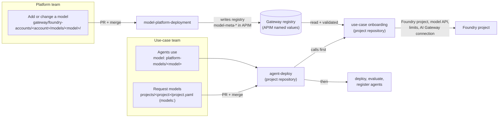
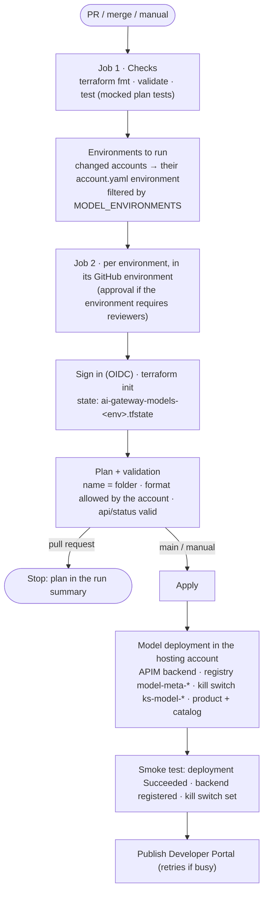

# AI gateway: model platform deployment and gateway policy deployment

Models are hosted **once**, in model-hosting Foundry accounts, and served **only through the AI gateway**
(Azure API Management). Foundry accounts that hold agents have **no model deployments**: their projects reach
models through an *AI Gateway connection*, and their agents use `"<connection>/<model>"`, e.g.
`platform-models/gpt-5.4-mini`.

This repository runs two pipelines: **model platform deployment** (is this model available on the platform?) and
**gateway policy deployment** (the shared policy fragments every model API and agent API includes,
[below](#gateway-policy-deployment-shared-policy-fragments)). Whether a use case can use a model, and how much, is
decided by **use-case onboarding** in the project repository
([agent-deployment](https://github.com/DeepuMM/agent-deployment#use-case-onboarding)): it creates the use case's
Foundry project, its model API on this gateway and its AI Gateway connection, reading the registry this repository
writes.

| | **Model platform deployment** (P2) |
|---|---|
| Question | Is this model available on the platform? |
| Change | `gateway/foundry-accounts/<account>/models/<model>/` |
| Owner | Platform team |
| Workflow | `.github/workflows/model-platform-deployment.yml` |
| Terraform stack | `gateway/terraform/platform-deployment` |
| State file | `ai-gateway-models-<env>.tfstate` |

How the objects sit in API Management next to the projects' APIs (products, APIs, operations, fragments, named
values, backends), with diagrams: [AI gateway (APIM) structure](../README.md#ai-gateway-apim-structure).

A new model is available to nobody until a project asks for it (use-case onboarding). A project can only ask for a
model that the gateway has registered.

```
gateway/foundry-accounts/<account>/models/<model>/            (project repository) projects/<project>/project.yaml
        │  model-platform-deployment                                │  use-case onboarding
        ▼                                                           ▼
  deployment in <account> ◄── APIM backend ◄──── models/<project> API ◄──── AI Gateway connection in the project's
  (capacity, guardrail)       registry model-meta-<model>  (token check, kill    own Foundry project; agents use
                              kill switch ks-model-<model> switch, token limits)  model: <connection>/<model>
```

## Pipeline flow: what happens when they run

### The big picture



### model-platform-deployment

**Triggers**

| Event | What runs |
|---|---|
| Pull request touching `gateway/foundry-accounts/**`, `gateway/terraform/platform-deployment/**` or `platform/environments/**` | checks and plan only; the plan is shown in the run summary |
| Merge to `main` with the same paths | checks, plan, **apply**, smoke test, Developer Portal |
| Manual (`workflow_dispatch`) | the same as main, for every enabled environment |



| Step | What it does | Fails when |
|---|---|---|
| Checks | Terraform format, validate, plan tests with mocked Azure | a file is badly formatted or a test fails |
| Environments to run | one run per platform environment of the changed hosting accounts (`account.yaml`), only if listed in `MODEL_ENVIRONMENTS` | — (nothing to run: the job is skipped) |
| Sign in + init | GitHub OIDC as the environment's pipeline identity; Terraform state in the environment's storage | the identity or its federated credential is missing |
| Plan | computes the changes and checks every `model.yaml` | does not fail on a bad `model.yaml` today: the checks only warn (see Validation) |
| Apply | deploys or updates each model in its hosting account; creates or updates its backend, registry entry, kill switch (only created, never re-enabled) and the product with the catalog | Azure refuses (quota, permissions) |
| Smoke test | reads the registry back from APIM and checks each model's deployment, backend and kill switch | a deployment isn't `Succeeded`, a backend is missing |
| Portal | publishes the Developer Portal | the portal is disabled on the APIM instance |

## Environments

Every definition says which platform environment it belongs to, and each pipeline run targets that environment's
Azure resources through the GitHub environment of the same name:

| Definition | Field | Default |
|---|---|---|
| `gateway/foundry-accounts/<account>/account.yaml` | `environment` | required |
| `projects/<project>/project.yaml` (project repository) | `environment` | `test` |

| Platform environment | Coordinates | GitHub environment |
|---|---|---|
| `test` | `platform/environments/test.yaml` | `model-test` |
| `sandbox` (disposable, `gateway/sandbox`) | `platform/environments/sandbox.yaml` | `sandbox` |

Each GitHub environment holds `AZURE_CLIENT_ID`, `AZURE_TENANT_ID`, `AZURE_SUBSCRIPTION_ID`. The repository variable **`MODEL_ENVIRONMENTS`** (e.g. `sandbox` or
`sandbox,test`) lists the environments the model pipelines and the gateway policy deployment may run in (currently
`sandbox`): add an environment only once its GitHub environment and pipeline identity are set up. `scripts/matrix.py` builds the job matrices from these fields.

## Developer Portal (APIM)

| What developers see | Where it comes from |
|---|---|
| Product **Platform models**: catalog of every model (summary, status, region, content safety, capacity, name to use in an agent) | model platform deployment: the first paragraph of each `docs.md` (stored in the registry as `summary`) |
| API **Models - &lt;project&gt;**: the project's models with its limits, and the chat completions reference (parameters, request example, error codes) | use-case onboarding (project repository): OpenAPI spec generated from the registry and `project.yaml` |

Model platform deployment and the project repository's pipelines publish the portal after each apply (`gateway/scripts/publish_portal.py`, which retries when another
run is publishing). The product is visible to the **Developers** group (signed-in users); with
`gateway.portal_anonymous: true` in the environment file (and GitHub variable `PORTAL_ANONYMOUS=true` for the agent
pipeline) also to **Guests**, for a portal without sign-in (the sandbox). The portal must be enabled on the APIM
instance (`developerPortalStatus`; v2 tiers start disabled): the publish step fails with the fix if it isn't. A new APIM instance's portal must be opened once from the Azure portal
(APIM > Developer portal) before it can be published; until then the script warns instead of failing.

## Single source of truth: the gateway

The **model registry is in APIM**, not in Git: model platform deployment writes one named value `model-meta-<model>` per
model, and everything that needs to know which models exist reads it from APIM:

- the project repository's use-case onboarding (validation, backend, deployment name, capacity) through
  `azapi_resource_list`;
- the smoke tests (`gateway/scripts/model_smoke.py` here, the onboarding smoke test there).

The project repository has no copy of `gateway/` at all.

Git holds what the platform team *wants* registered; APIM holds what *is* registered, and only the pipelines
write it. A use-case team types only a model name and its limits.

| Named value in APIM | Value | Written by | Read by |
|---|---|---|---|
| `model-meta-<model>` | JSON: name, api, status, format, model, version, hosting account, region, deployment, `capacity_tpm`, guardrail, backend ID, kill switch | model platform deployment | model project connection, smoke tests, project pipelines |
| `ks-model-<model>` | `active` or `suspended` | model platform deployment (once); then operations only | the project model API policies |
| `ks-gateway-all` | `active` or `suspended`: stops every agent and model API on the gateway | gateway policy deployment (once); then operations only | the fragments `agent-guardrails` and `model-api-route` |
| `model-limit-<project>-<model>` | JSON: project, model, `tokens_per_minute`, `tokens_per_day` | model project connection | model project connection of every other project (free capacity) |

APIM names allow no dots, so `<model>` in these names is the model name with dots replaced by hyphens
(`gpt-5.4-mini` → `gpt-5-4-mini`). The registry entry keeps the real name.

## Model platform deployment

### Add or change a model

1. Create `gateway/foundry-accounts/<account>/models/<model>/` (or edit it):

   | File | What it is |
   |---|---|
   | `model.yaml` | gateway model name (= folder name), API, status, model (format, name, version), deployment (name, SKU, capacity, version upgrade, `existing`), guardrail |
   | `docs.md` | model card for the developer portal |
   | `tests.yaml` | smoke tests run through the gateway by an agent that uses the model |

2. Open a pull request: `model-platform-deployment` checks format, validates, runs the plan tests and shows the plan.
3. Merge to main: plan, **approval** on the environment's GitHub environment (`model-test`, `sandbox`), apply, smoke test.

A new hosting account (e.g. another region for Claude Sonnet) is a new folder
`gateway/foundry-accounts/<account>/` with `account.yaml` (subscription, resource group, region, allowed model
formats). Only folders under `gateway/foundry-accounts/` can receive models, so a model can never be deployed
into an agent account.

### What it creates per model

| Resource | Name | Notes |
|---|---|---|
| Model deployment | `deployment.name` in the hosting account | SKU, capacity, guardrail (`raiPolicyName`), version upgrade. `existing: true` adopts a deployment made before this pipeline (Terraform `import`) instead of recreating it |
| APIM backend | `model-<account>-<deployment>` | `https://<account>.cognitiveservices.azure.com/openai` |
| Registry entry | named value `model-meta-<model>` | see above |
| Kill switch | named value `ks-model-<model>` | created `active`; later changes are never overwritten by an apply |
| Product | `platform-models` (from the environment file) | catalog of every model in its description; visible to the Developers group; every project's model API is added to it |

### Validation (warnings in the plan, not yet blocking)

The plan checks each model's definition, but these checks are a Terraform `check` block: they show a warning and the
run continues. Review the plan's warnings on the pull request.

- `model.yaml` `name` equals its folder name; names are lowercase letters, digits, dots and hyphens.
- The model's format is one of its hosting account's `formats`.
- `api` is `openai`; `status` is `active` or `deprecated`.

## Use-case onboarding (project repository)

A project's access to models is set up by the project repository's use-case onboarding, not here: per project, its
Foundry project, model API `models/<project>` (only that project's identity; routing table per allowed model with
token limits and content safety settings; the shared fragments `model-api-caller`, `model-api-route`,
`model-content-safety`, `project-outbound`), its allocation `model-limit-<project>-<model>` (checked against free
capacity in this registry) and its AI Gateway connection. See
[agent-deployment: use-case onboarding](https://github.com/DeepuMM/agent-deployment#use-case-onboarding).

## Gateway policy deployment (shared policy fragments)

The policy logic shared by every project model API, project agent API and agent operation is in APIM policy
fragments, one per file in `gateway/policy-fragments/`. Their own pipeline deploys them to **every** environment's
gateway; the agent and project pipelines only write thin policies that include them by name.

| | |
|---|---|
| Change | `gateway/policy-fragments/<id>.xml` (file name = fragment ID) |
| Workflow | `.github/workflows/gateway-policy-deployment.yml` |
| Terraform stack | `gateway/terraform/gateway-policies` (fragments, the named values `gateway-tenant-id` and `ks-gateway-all` (global kill switch), and the Content Safety backend `content-safety`) |
| State file | `ai-gateway-policies-<env>.tfstate` |
| Environments | every `platform/environments/<env>.yaml`, in its model GitHub environment (`test` → `model-test`), filtered by `MODEL_ENVIRONMENTS` |

| Step | What it does | Fails when |
|---|---|---|
| Checks | Terraform format, validate, plan tests with mocked Azure | a file is badly formatted or a test fails |
| Plan | one fragment per file | a file's root isn't `<fragment>`, or an environment file has no `gateway.content_safety` |
| Apply (main, after approval) | creates or updates the fragments and `gateway-tenant-id`; creates `ks-gateway-all` as `active` (never changed afterwards) | APIM rejects the XML |
| Smoke test | every fragment file is on the gateway; global kill switch state; `model_smoke.py models` | a fragment is missing on the gateway, or a model check fails |

The project repository's `agent-deploy` (`register`) and use-case onboarding (plan) both check that the fragments
they include are on the gateway, and stop with "run gateway-policy-deployment first" if not; each project's next run
(or a manual run) verifies a fragment change end to end. A fragment change reaches every project
at once and has no evaluation gate: review it like platform code.

## Kill switch, rollback, retirement

- **Stop a model for everyone:** APIM → Named values → `ks-model-<model>` → `suspended`. Callers get
  `503 AI_ROUTE_SUSPENDED`. No pipeline run re-enables it.
- **Stop everything on the gateway:** `ks-gateway-all` → `suspended` (every agent and model API). How the three kill
  switches (gateway, model, agent) work together: [Kill switches](../README.md#kill-switches).
- **Stop one project's access:** remove the model from its `models.allowed` (or set a very low limit) and merge.
- **Roll back a model change:** revert the commit and merge; the plan shows the change back.
- **Retire a model:** set `status: deprecated` (still served, visible in the registry and smoke test), ask the
  projects to move, then delete the folder once no `model-limit-*-<model>` remains.

## Workflows and triggers

| Change | What runs |
|---|---|
| `gateway/foundry-accounts/**`, `gateway/terraform/platform-deployment/**`, `platform/environments/**` | `model-platform-deployment` (PR: checks + plan; main: apply + smoke) |
| `gateway/policy-fragments/**`, `gateway/terraform/gateway-policies/**`, `platform/environments/**` | `gateway-policy-deployment`, every environment (PR: checks + plan; main: apply + gateway smoke test) |

Projects, onboarding and agents: the project repository's workflows.

## Identity and permissions

| Who | Role | Scope |
|---|---|---|
| Pipeline identity (GitHub OIDC) | Foundry Account Owner (deploy models, set guardrails) | each hosting account |
| | API Management Service Contributor | the APIM instance |
| | Contributor or Foundry Project Manager (projects, connections), Foundry User (agents, evaluations): used by the project repository | the agent Foundry account / its resource group |
| | Storage Blob Data Contributor | the Terraform state container |
| APIM managed identity | Foundry User (call the deployments) | each hosting account |
| | Cognitive Services User (prompt checks) | the Azure AI Content Safety account (`gateway.content_safety`) |
| Foundry project managed identity | none on the hosting accounts | it only calls APIM |

GitHub environments `model-test` (with required reviewers) and `sandbox` (identity `id-sbx-pipeline`, which trusts
both repositories' `sandbox` environments); variables `AZURE_CLIENT_ID`, `AZURE_TENANT_ID`, `AZURE_SUBSCRIPTION_ID`.
Everything else comes from `platform/environments/<env>.yaml`.

## Run locally

```bash
az login
cd gateway/terraform/platform-deployment
terraform init -backend-config="resource_group_name=rg-ai-gateway-sandbox" \
  -backend-config="storage_account_name=sttfsbxbbf0o" -backend-config="container_name=tfstate" \
  -backend-config="key=ai-gateway-models-sandbox.tfstate" -backend-config="use_azuread_auth=true"
terraform test                         # plan tests with mocked providers, no Azure access
terraform plan -var environment=sandbox  # state storage from platform/environments/sandbox.yaml

cd ../gateway-policies                             # same init with key ai-gateway-policies-<env>.tfstate
terraform test
terraform plan -var environment=sandbox

python gateway/scripts/model_smoke.py models sandbox
python gateway/scripts/publish_portal.py sandbox
```

## Sandbox

`gateway/sandbox` creates a disposable copy of the platform in one resource group: model-hosting Foundry account,
agent-only Foundry account (its projects are created by the project repository's onboarding), APIM Basic v2, an Azure AI Content Safety account
(`cs-sbx-<suffix>`, with APIM's Cognitive Services User role on it), Terraform state storage, and the pipeline
identity `id-sbx-pipeline` trusted by both repositories' GitHub environment `sandbox`. Its state is local to
`gateway/sandbox` (not in Git). `platform/environments/sandbox.yaml` and `gateway/foundry-accounts/aif-sbx-models-*/`
point at it here; `projects/models-demo/` and `projects/proj-default/` in the project repository. `terraform destroy`
in `gateway/sandbox` removes everything (the Foundry projects go with the agent account); then delete those paths,
the `sandbox` GitHub environments and `sandbox` from `MODEL_ENVIRONMENTS` in both repositories.

## Tested end to end (sandbox, 13 Nov 2026)

In `gateway/sandbox` (separate hosting and agent-only Foundry accounts, APIM Basic v2), environment `sandbox`:

| Check | Result |
|---|---|
| Model platform deployment: deployment, backend, registry, kill switch, product (5 resources) | created; smoke test: deployment Succeeded, backend registered, kill switch active |
| Model project connection for `models-demo`: plan reads the registry from APIM, checks capacity (20,000 of 50,000 TPM) | 7 resources created: model API, policy, product link, allocation, AI Gateway connection |
| Prompt agent in the agent-only project with `model: platform-models/gpt-5.4-mini` | answers through the gateway |
| Another identity calling the project's model API | refused (401) |
| Kill switch `ks-model-gpt-5-4-mini` = suspended | the agent's call fails with `503 AI_ROUTE_SUSPENDED`, passed through by Foundry |
| Agent pipeline: deploy + evaluation gate with `judge_model: platform-models/gpt-5.4-mini` | passed (relevance 3/3, coherence 3/3) |

## Tested end to end (sandbox, 16 Nov 2026): shared policy fragments

| Check | Result |
|---|---|
| `gateway-policy-deployment`: 6 fragments and `gateway-tenant-id` on `apim-sbx-bbf0o` | created (first apply failed, see below; fixed and re-applied) |
| `model-project-connection` for `models-demo`: model API on the thin policy (routing table + `model-api-caller` / `model-api-route`) | 1 changed; an agent answers with `platform-models/gpt-5.4-mini`, another identity is refused (401) |
| `agent-deploy` for `models-demo`: agent API on the thin policies (`agent-guardrails`, `agent-pin-version`, `project-inbound`, `project-outbound`) | smoke test 1/1 through the gateway |
| `agent-deploy` for `proj-default` (first deploy in the sandbox, in the `models-demo` Foundry project) | `expense-policy-agent` v1 and `leave-policy-agent` v1 passed the evaluation gate (judge `platform-models/gpt-5.4-mini`); smoke test 7/7 through `ai/proj-default` |
| Agent change through the pipeline: one instruction line in `demo-assistant` | v2 deployed, evaluation gate passed (relevance 3/3, coherence 3/3), gateway moved `agent-version-demo-assistant` to 2, smoke test 1/1; v2 uses `platform-models/gpt-5.4-mini` |
| Global kill switch `ks-gateway-all` (created by `gateway-policy-deployment`) set to `suspended`, then back to `active` | agent call through `ai/models-demo`: `200` → `503 AI_ROUTE_SUSPENDED` "All AI routes on this gateway are suspended…" → `200` |
| Content safety at the gateway, platform defaults (fragment `model-content-safety`, Content Safety `cs-sbx-bbf0o`) | 8 legitimate questions answered; jailbreak prompt blocked (`403 Request failed content safety check`); a weapon request reached the model, which refused |
| Content safety with `models-demo` `content_safety.violence: 2` | per-project setting written to the policy and applied; 3 legitimate `proj-default` questions got `403`, most likely Content Safety outages (see next row) rather than the threshold; `models-demo` returned to the defaults |
| Intermittent `403` at the platform defaults, investigated with gateway logs | 7 of 28 legitimate questions blocked; all 7 were Content Safety `InternalError: no healthy upstream` (service unavailable), which `llm-content-safety` treats as a block; identical requests passed otherwise. Not fixed yet: [Known issue](../README.md#known-issue-content-safety-outages-look-like-content-blocks) |
| Two pipelines smoke-testing the same project at once | they shared the temporary smoke agent and failed each other; fixed (one agent name per run) |
| Agents use the model only through the gateway | all agents' `model` is `platform-models/gpt-5.4-mini`; connection `platform-models` targets `apim-sbx-bbf0o/models/models-demo`; the agent-only account has no deployments; the model API served the evaluation and smoke traffic |

**What APIM accepts as policy expressions** (found by the first apply, then checked one by one on the sandbox):

| Policy attribute | Expression allowed |
|---|---|
| `rate-limit-by-key calls` | yes |
| `quota-by-key calls` | **no**: literal integer only, so the daily quotas stay in the agent and project policies |
| `llm-token-limit tokens-per-minute` | yes, must return `int` |
| `llm-token-limit token-quota` | yes, must return `long` (`@(…L)`) |
| `set-backend-service backend-id`, `rewrite-uri template` | yes |

## Limits and notes

- Connected models (AI Gateway connections) are documented by Microsoft for **prompt agents**; hosted agents
  call the project's model API directly with their own identity. The connection type `ApiManagement` is in
  preview and can only be created through code.
- **Guardrails** set on an agent don't apply to connected models: content safety is the guardrail on the
  deployment in the hosting account (`guardrail` in `model.yaml`), plus the gateway's Content Safety check on every
  prompt (fragment `model-content-safety`, [Content safety](../README.md#content-safety)).
- **Evaluations work with a connected model as the AI judge** (`judge_model: platform-models/<model>`): verified in
  the sandbox, where the agent account has no deployments at all. Other features that may need a model in the
  agent's own account (file search embeddings, memory, Foundry IQ) still need checking before relying on them.
- `api: anthropic` (Claude, Messages route) is not supported yet: the model API has only the chat completions
  operation.
