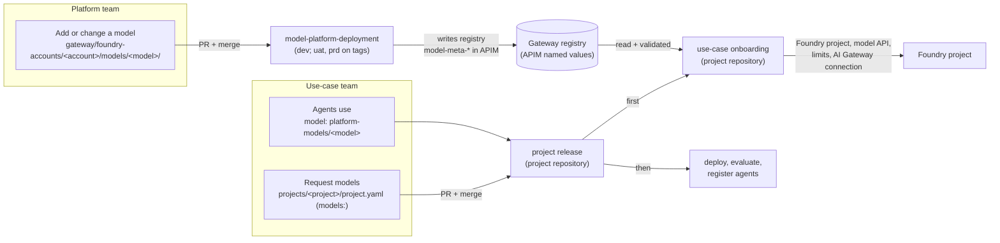
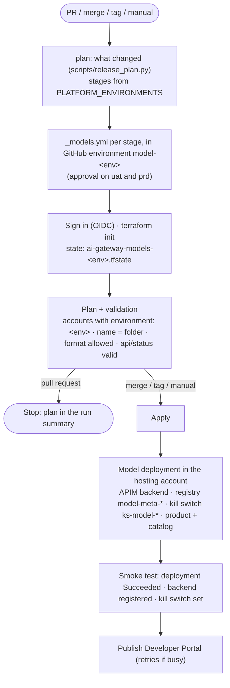

# AI gateway: models and the shared gateway policy

Models are hosted **once**, in model-hosting Foundry accounts, and served **only through the AI gateway**
(Azure API Management). Foundry accounts that hold agents have **no model deployments**: their projects reach
models through an *AI Gateway connection*, and their agents use `"<connection>/<model>"`, e.g.
`platform-models/gpt-5.4-mini`.

This repository releases two things, through one release workflow with stages dev → uat → prd
([Pipelines](../README.md#pipelines)): the **models** (is this model available on the platform? `model-platform-deployment`) and
the **gateway policy** (the shared policy fragments every model, tool and agent API includes, `gateway-policy-deployment`,
[below](#gateway-policy-the-shared-policy-fragments)). Whether a use case can use a model, and how much, is
decided by **use-case onboarding** in the project repository
([agent-deployment](https://github.com/DeepuMM/agent-deployment#use-case-onboarding)): it creates the use case's
Foundry project, its model API on this gateway and its AI Gateway connection, reading the registry this repository
writes.

| | **Models** (P2) |
|---|---|
| Question | Is this model available on the platform? |
| Change | `gateway/foundry-accounts/<account>/models/<model>/` |
| Owner | Platform team |
| Workflow | `model-platform-deployment.yml` (unit `_models.yml`) |
| Terraform stack | `gateway/terraform/platform-deployment` |
| State file | `ai-gateway-models-<env>.tfstate` |

How the objects sit in API Management next to the projects' APIs (products, APIs, operations, fragments, named
values, backends), with diagrams: [AI gateway (APIM) structure](../README.md#ai-gateway-apim-structure).

A new model is available to nobody until a project asks for it (use-case onboarding). A project can only ask for a
model that the gateway has registered.

```
gateway/foundry-accounts/<account>/models/<model>/            (project repository) projects/<project>/project.yaml
        │  model-platform-deployment                                │  use-case onboarding
        ▼                                                           ▼
  deployment in <account> ◄── APIM backend ◄──── models/<project> API ◄──── AI Gateway connection in the project's
  (capacity, guardrail)       registry model-meta-<model>  (token check, kill    own Foundry project; agents use
                              kill switch ks-model-<model> switch, token limits)  model: <connection>/<model>
```

## Pipeline flow: what happens when they run

### The big picture



### model-platform-deployment

**Triggers** (`model-platform-deployment.yml`)

| Event | What runs |
|---|---|
| Pull request touching `gateway/foundry-accounts/**` or `gateway/terraform/platform-deployment/**` | plan in dev; the plan is shown in the run summary |
| Merge to `main` with the same paths | stage dev: plan, **apply**, smoke test, Developer Portal |
| Release tag `v*`, manual run | every job: dev (and on a tag uat, prd after approval, when `PLATFORM_ENVIRONMENTS` lists them) |



| Step | What it does | Fails when |
|---|---|---|
| Checks (`ci.yml`) | Terraform format, validate, plan tests with mocked Azure | a file is badly formatted or a test fails |
| Plan (`plan` job) | which jobs run in the stage | — |
| Sign in + init | GitHub OIDC as the environment's pipeline identity; Terraform state in the environment's storage (GitHub variables) | the identity or its federated credential is missing |
| Plan | computes the changes for the hosting accounts of the stage's environment and checks every `model.yaml` | does not fail on a bad `model.yaml` today: the checks only warn (see Validation) |
| Apply | deploys or updates each model in its hosting account; creates or updates its backend, registry entry, kill switch (only created, never re-enabled) and the product with the catalog | Azure refuses (quota, permissions) |
| Smoke test | reads the registry back from APIM and checks each model's deployment, backend and kill switch | a deployment isn't `Succeeded`, a backend is missing |
| Portal | publishes the Developer Portal | the portal is disabled on the APIM instance |

## Environments

| Definition | Field | Meaning |
|---|---|---|
| `gateway/foundry-accounts/<account>/account.yaml` | `environment` | the one environment whose `model-platform-deployment` run deploys this account (`dev`) |
| `projects/<project>/project.yaml` (project repository) | `environments` | the stages the project deploys to, in order (default `[dev]`) |
| repository variable `PLATFORM_ENVIRONMENTS` | | the stages this repository deploys to, in order (`dev`) |

| Environment | GitHub environment | Approval | Coordinates |
|---|---|---|---|
| `dev` | `model-dev` | none | GitHub variables of `model-dev` ([list](../README.md#environment-settings-github-variables)) |
| `uat`, `prd` | `model-uat`, `model-prd` | required reviewers | the same as dev until their own resources exist; not in `PLATFORM_ENVIRONMENTS` yet |
| `sandbox` (disposable, `gateway/sandbox`) | `sandbox` | — | not a stage; tried by hand |

## Developer Portal (APIM)

| What developers see | Where it comes from |
|---|---|
| Product **Platform models**: catalog of every model (summary, status, region, content safety, capacity, name to use in an agent) | model platform deployment: the first paragraph of each `docs.md` (stored in the registry as `summary`) |
| API **Models - &lt;project&gt;**: the project's models with its limits, and the chat completions reference (parameters, request example, error codes) | use-case onboarding (project repository): OpenAPI spec generated from the registry and `project.yaml` |

Model platform deployment and the project repository's pipelines publish the portal after each apply (`gateway/scripts/publish_portal.py`, which retries when another
run is publishing). The product is visible to the **Developers** group (signed-in users); with
the GitHub variable `PORTAL_ANONYMOUS=true` (both repositories) also to **Guests**, for a portal without sign-in (the sandbox). The portal must be enabled on the APIM
instance (`developerPortalStatus`; v2 tiers start disabled): the publish step fails with the fix if it isn't. A new APIM instance's portal must be opened once from the Azure portal
(APIM > Developer portal) before it can be published; until then the script warns instead of failing.

## Single source of truth: the gateway

The **model registry is in APIM**, not in Git: model platform deployment writes one named value `model-meta-<model>` per
model, and everything that needs to know which models exist reads it from APIM:

- the project repository's use-case onboarding (validation, backend, deployment name, capacity) through
  `azapi_resource_list`;
- the smoke tests (`gateway/scripts/model_smoke.py` here, the onboarding smoke test there).

The project repository has no copy of `gateway/` at all.

Git holds what the platform team *wants* registered; APIM holds what *is* registered, and only the pipelines
write it. A use-case team types only a model name and its limits.

| Named value in APIM | Value | Written by | Read by |
|---|---|---|---|
| `model-meta-<model>` | JSON: name, api, status, format, model, version, hosting account, region, deployment, `capacity_tpm`, guardrail, backend ID, kill switch | model platform deployment | model project connection, smoke tests, project pipelines |
| `ks-model-<model>` | `active` or `suspended` | model platform deployment (once); then operations only | the project model API policies |
| `ks-gateway-all` | `active` or `suspended`: stops every agent and model API on the gateway | gateway policy deployment (once); then operations only | the fragments `agent-guardrails` and `model-api-route` |
| `model-limit-<project>-<model>` | JSON: project, model, `tokens_per_minute`, `tokens_per_day` | model project connection | model project connection of every other project (free capacity) |

APIM names allow no dots, so `<model>` in these names is the model name with dots replaced by hyphens
(`gpt-5.4-mini` → `gpt-5-4-mini`). The registry entry keeps the real name.

## Model platform deployment

### Add or change a model

1. Create `gateway/foundry-accounts/<account>/models/<model>/` (or edit it):

   | File | What it is |
   |---|---|
   | `model.yaml` | gateway model name (= folder name), API, status, model (format, name, version), deployment (name, SKU, capacity, version upgrade, `existing`), guardrail |
   | `docs.md` | model card for the developer portal |
   | `tests.yaml` | smoke tests run through the gateway by an agent that uses the model |

2. Open a pull request: `ci` checks format, validates and runs the plan tests; `model-platform-deployment` shows the plan in dev.
3. Merge to main: dev applies and runs the smoke test. A release tag then promotes it to uat and prd, each after
   approval, once they are in `PLATFORM_ENVIRONMENTS` and have their own hosting accounts.

A new hosting account (e.g. another region for Claude Sonnet) is a new folder
`gateway/foundry-accounts/<account>/` with `account.yaml` (environment, subscription, resource group, region,
allowed model formats). Only folders under `gateway/foundry-accounts/` can receive models, so a model can never be deployed
into an agent account.

### What it creates per model

| Resource | Name | Notes |
|---|---|---|
| Model deployment | `deployment.name` in the hosting account | SKU, capacity, guardrail (`raiPolicyName`), version upgrade. `existing: true` adopts a deployment made before this pipeline (Terraform `import`) instead of recreating it |
| APIM backend | `model-<account>-<deployment>` | `https://<account>.cognitiveservices.azure.com/openai` |
| Registry entry | named value `model-meta-<model>` | see above |
| Kill switch | named value `ks-model-<model>` | created `active`; later changes are never overwritten by an apply |
| Product | `platform-models` (GitHub variable `MODELS_PRODUCT`) | catalog of every model in its description; visible to the Developers group; every project's model API is added to it |

### Validation in the plan

The plan checks each model's definition in a Terraform `check` block. Findings appear as warnings in the plan on the
pull request; the reviewer approves only a plan without warnings.

- `model.yaml` `name` equals its folder name; names are lowercase letters, digits, dots and hyphens.
- The model's format is one of its hosting account's `formats`.
- `api` is `openai`; `status` is `active` or `deprecated`.

## Use-case onboarding (project repository)

A project's access to models is set up by the project repository's use-case onboarding, not here: per project, its
Foundry project, model API `models/<project>` (only that project's identity; routing table per allowed model with
token limits and content safety settings; the shared fragments `model-api-caller`, `model-api-route`,
`model-content-safety`, `project-outbound`), its allocation `model-limit-<project>-<model>` (checked against free
capacity in this registry) and its AI Gateway connection. See
[agent-deployment: use-case onboarding](https://github.com/DeepuMM/agent-deployment#use-case-onboarding).

Tools (MCP servers) belong to projects too: the project repository's `tool` job creates, per project-owned
tool, a gateway API `tools/<project>/<tool>/mcp` whose policy includes the shared fragments `tool-caller` and
`tool-route`, its kill switch `ks-tool-<project>-<tool>` and its registry entry `tool-meta-<project>-<tool>`;
onboarding creates the Foundry RemoteTool connections of the projects that use it.
This repository owns only the two fragments. When a tool's backend needs credentials, the gateway uses APIM's managed
identity, and the team that owns the tool grants it access. See
[agent-deployment: tools](https://github.com/DeepuMM/agent-deployment#tools-project-owned-mcp-servers).

## Gateway policy: the shared policy fragments

The policy logic shared by every project model API, tool API, project agent API and agent operation is in APIM
policy fragments, one per file in `gateway/policy-fragments/`. `gateway-policy-deployment` deploys them, stage by stage;
the agent and project pipelines only write thin policies that include them by name.

| | |
|---|---|
| Change | `gateway/policy-fragments/<id>.xml` (file name = fragment ID) |
| Workflow | `gateway-policy-deployment.yml` (unit `_policies.yml`) |
| Terraform stack | `gateway/terraform/gateway-policies` (fragments, the named values `gateway-tenant-id` and `ks-gateway-all` (global kill switch), the Content Safety backend `content-safety`, the Application Insights logger) |
| State file | `ai-gateway-policies-<env>.tfstate` |
| Stages | dev on merge; uat and prd on release tags, after approval, when `PLATFORM_ENVIRONMENTS` lists them |

| Step | What it does | Fails when |
|---|---|---|
| Checks (`ci.yml`) | Terraform format, validate, plan tests with mocked Azure | a file is badly formatted or a test fails |
| Plan | one fragment per file | a file's root isn't `<fragment>`, or the environment has no Content Safety account (GitHub variables) |
| Apply | creates or updates the fragments and `gateway-tenant-id`; creates `ks-gateway-all` as `active` (never changed afterwards) | APIM rejects the XML |
| Smoke test | every fragment file is on the gateway; global kill switch state; `model_smoke.py models` | a fragment is missing on the gateway, or a model check fails |

The project repository's agent release (`register`) and onboarding plan both check that the fragments they include
are on the gateway, and stop with "run the gateway policy first" if not; each project's next run (or a manual run)
verifies a fragment change end to end. A fragment change reaches every project of an environment at once and has no
evaluation gate: review it like platform code, and let it prove itself in dev before tagging.

## Kill switch, rollback, retirement

- **Stop a model for everyone:** APIM → Named values → `ks-model-<model>` → `suspended`. Callers get
  `503 AI_ROUTE_SUSPENDED`. No pipeline run re-enables it.
- **Stop everything on the gateway:** `ks-gateway-all` → `suspended` (every agent and model API). How the kill
  switches (gateway, model, agent) work together: [Kill switches](../README.md#kill-switches).
- **Stop one project's access:** remove the model from its `models.allowed` (or set a very low limit) and merge.
- **Roll back a model change:** revert the commit and merge; the plan shows the change back.
- **Retire a model:** set `status: deprecated` (still served, visible in the registry and smoke test), ask the
  projects to move, then delete the folder once no `model-limit-*-<model>` remains.

## Workflows and triggers

| Change | What runs |
|---|---|
| `gateway/foundry-accounts/**`, `gateway/terraform/platform-deployment/**` | `model-platform-deployment` (PR: plan in dev; merge: dev apply + smoke) |
| `gateway/policy-fragments/**`, `gateway/terraform/gateway-policies/**` | `gateway-policy-deployment` (PR: plan in dev; merge: dev apply + gateway smoke test) |
| release tag `v*`, manual run | both pipelines; on a tag dev, then uat and prd after approval |
| anything (`ci.yml`) | format, validate and plan tests of both stacks |

Projects, onboarding, tools and agents: the project repository's workflows.

## Identity and permissions

| Who | Role | Scope |
|---|---|---|
| Pipeline identity (GitHub OIDC) | Foundry Account Owner (deploy models, set guardrails) | each hosting account |
| | API Management Service Contributor | the APIM instance |
| | Contributor or Foundry Project Manager (projects, connections), Foundry User (agents, evaluations): used by the project repository | the agent Foundry account / its resource group |
| | Storage Blob Data Contributor | the Terraform state container |
| APIM managed identity | Foundry User (call the deployments) | each hosting account |
| | Cognitive Services User (prompt checks) | the Azure AI Content Safety account (`CONTENT_SAFETY_ACCOUNT`) |
| Foundry project managed identity | none on the hosting accounts | it only calls APIM |

GitHub environments `model-dev`, `model-uat` and `model-prd` (the last two with required reviewers), each with a
federated credential on the pipeline identity; their variables hold the environment's coordinates
([list](../README.md#environment-settings-github-variables)). The sandbox has its own identity `id-sbx-pipeline`.

## Run locally

```bash
az login
eval "$(gh variable list --env model-dev --json name,value -q '.[] | "export \(.name)=\(.value)"')"
export TF_VAR_environment=dev TF_VAR_apim_subscription_id=$APIM_SUBSCRIPTION_ID TF_VAR_apim_resource_group=$APIM_RESOURCE_GROUP \
  TF_VAR_apim_name=$APIM_NAME TF_VAR_models_product=$MODELS_PRODUCT
cd gateway/terraform/platform-deployment
terraform test                         # plan tests with mocked providers, no Azure access
terraform init -backend-config="resource_group_name=$TF_STATE_RESOURCE_GROUP" \
  -backend-config="storage_account_name=$TF_STATE_STORAGE_ACCOUNT" -backend-config="container_name=$TF_STATE_CONTAINER" \
  -backend-config="key=ai-gateway-models-dev.tfstate" -backend-config="use_azuread_auth=true"
terraform plan

cd ../gateway-policies                 # same init with key ai-gateway-policies-dev.tfstate; also TF_VAR_tenant_id,
terraform test                         # TF_VAR_content_safety_*, TF_VAR_app_insights_* (see the main README)
cd ../../..
python gateway/scripts/model_smoke.py models
python gateway/scripts/publish_portal.py
```

## Sandbox

`gateway/sandbox` creates a disposable copy of the platform in one resource group: model-hosting Foundry account,
agent-only Foundry account (its projects are created by the project repository's onboarding), APIM Basic v2, an Azure AI Content Safety account
(`cs-sbx-<suffix>`, with APIM's Cognitive Services User role on it), Terraform state storage, and the pipeline
identity `id-sbx-pipeline` trusted by both repositories' GitHub environment `sandbox`. Its state is local to
`gateway/sandbox` (not in Git). Its output is the set of values for `scripts/set_github_environment.sh`;
`gateway/foundry-accounts/aif-sbx-models-*/` (`environment: sandbox`) holds its models. The sandbox is not a stage:
it is for trying platform changes by hand. `terraform destroy` in `gateway/sandbox` removes everything (the Foundry
projects go with the agent account); then delete that folder and the `sandbox` GitHub environments in both
repositories.

## Verifying an environment

After the first deployment to a new environment, and after platform changes, check the platform end to end. The
pipelines' smoke tests cover most rows; the others are one-off manual checks.

| Check | Proves | How |
|---|---|---|
| Models applied | deployment, backend, registry entry, kill switch and product exist per model | `models` smoke test |
| Gateway policy applied | every shared fragment, `gateway-tenant-id`, `ks-gateway-all` and the Content Safety backend are on the gateway | `policies` smoke test |
| A project's agent answers through its model connection | onboarding wired the project's model API and AI Gateway connection | onboarding smoke test (temporary agent) |
| Another identity calls a project's model API | only the project's Foundry identity is accepted (`401` otherwise) | onboarding smoke test |
| The same prompt in two projects with different content-safety settings | per-project thresholds are applied at the gateway | onboarding smoke test (content-safety proof) |
| An agent change goes through deploy → evaluation → gateway | only evaluated versions are served (`agent-version-<agent>` moves only after the gate) | the project's release (`_agents`) |
| `ks-model-<model>`, `ks-agent-<agent>`, `ks-gateway-all` set to `suspended`, then `active` | each kill switch stops its scope (`503 AI_ROUTE_SUSPENDED`) and resumes | manual, through the gateway |
| Token metrics in Application Insights | usage is recorded per project/model and per agent/consumer | KQL in [Token metrics](../README.md#token-metrics) |
| Two pipeline runs for the same project at once | runs don't interfere (each run uses its own temporary smoke agent) | trigger two runs |

## Policy expressions APIM accepts

Which policy attributes take a policy expression decides where each value lives: values that can be expressions are
set per project or agent as context variables and read by the shared fragments; the others stay literal in the
project and agent policies.

| Policy attribute | Expression allowed |
|---|---|
| `rate-limit-by-key calls` | yes |
| `quota-by-key calls` | **no**: literal integer only, so the daily quotas stay in the agent and project policies |
| `llm-token-limit tokens-per-minute` | yes, must return `int` |
| `llm-token-limit token-quota` | yes, must return `long` (`@(…L)`) |
| `set-backend-service backend-id`, `rewrite-uri template` | yes |
| `llm-content-safety` `threshold`, `shield-prompt`, `enforce-on-completions` | yes |

## Limits and notes

- Agents reach platform models through the project's **AI Gateway connection** (`<connection>/<model>`): prompt
  agents through their definition, hosted (code) agents by calling the Foundry project endpoint with that model name
  (the pipeline passes it as `AZURE_AI_MODEL_DEPLOYMENT_NAME`). Either way Foundry calls the gateway with the
  project's identity. The connection type `ApiManagement` is in preview and is created through code (onboarding).
- **Guardrails** set on an agent don't apply to connected models: content safety is the guardrail on the
  deployment in the hosting account (`guardrail` in `model.yaml`), plus the gateway's Content Safety check on every
  prompt (fragment `model-content-safety`, [Content safety](../README.md#content-safety)).
- **Evaluations use a connected model as the AI judge** (`judge_model: <connection>/<model>`), so the agent account
  needs no model deployments. Features that need a model in the agent's own account (file search embeddings,
  memory, Foundry IQ) are outside this reference; check them before using them.
- The model API exposes the chat completions operation (`api: openai`). Other model APIs (for example `anthropic`,
  Messages) need their own operation and route in the model API.
